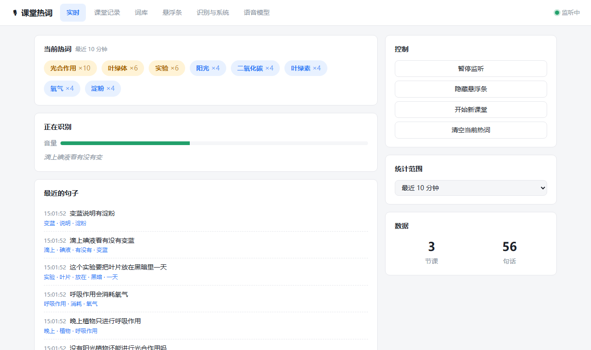
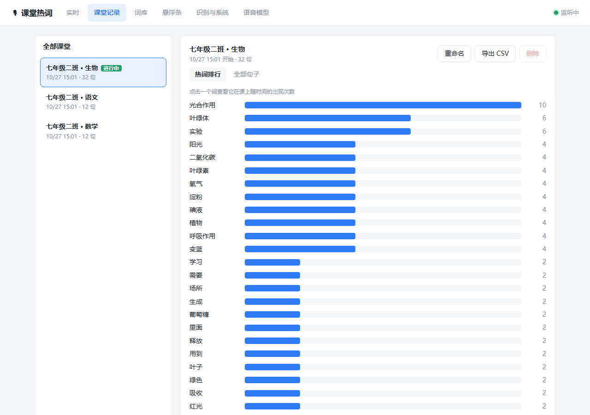
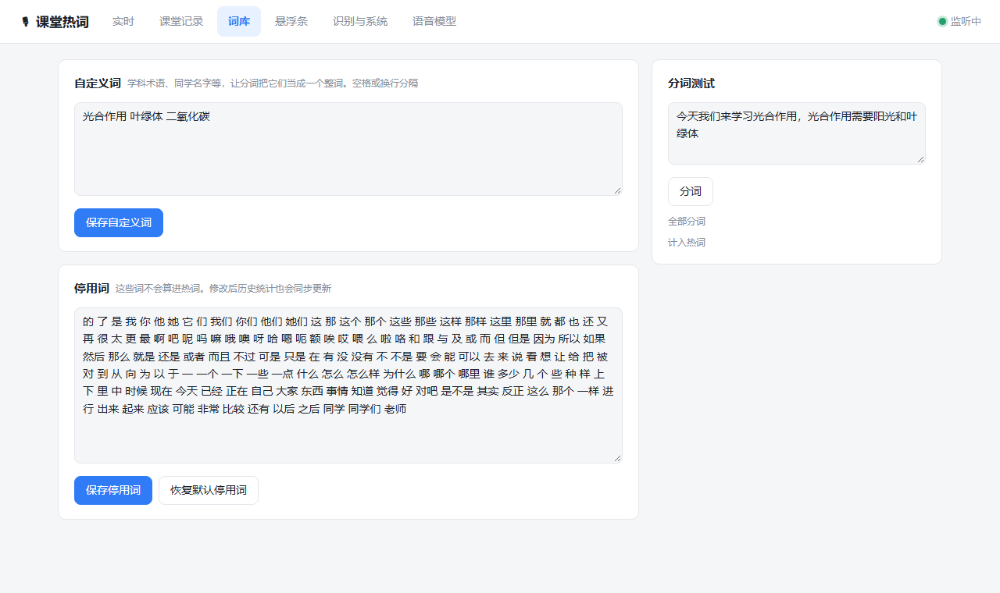
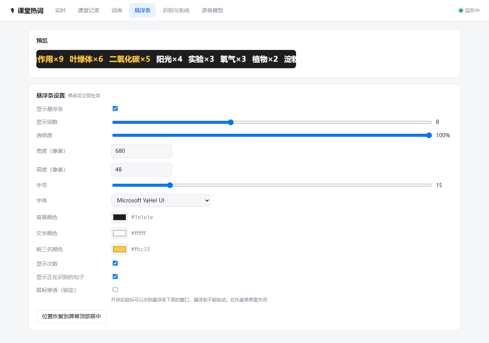
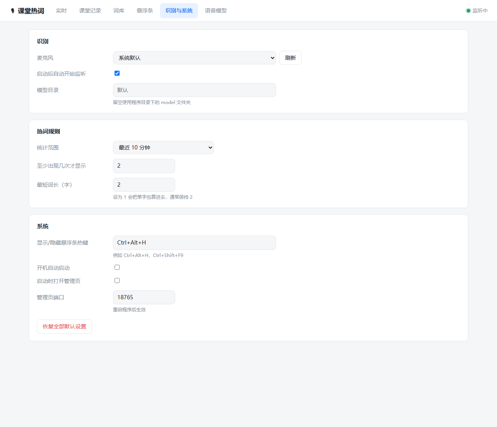
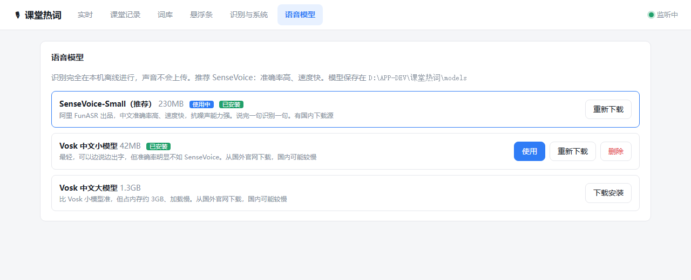

# 课堂热词

**把课堂上大家说得最多的词，实时显示在屏幕顶部。**

程序监听教室里的麦克风，用 SenseVoice 模型在本机离线识别同学说的话，用 jieba 分词，统计最近一段时间里出现得最多的词，显示在屏幕顶部的半透明悬浮条上。平时缩在托盘里运行；设置、课堂记录、词库都在浏览器里的本地管理页中管理。


- 🎯 **识别准**：默认使用阿里 FunASR 的 SenseVoice-Small，在我们的测试里字错误率约 2%，比 Vosk 小模型低三分之二以上（见[识别效果对比](#识别效果对比)）
- 🔒 **完全离线**：识别在本机进行，声音不上传、不保存录音
- 🪟 **不挡视线**：悬浮条小巧半透明，始终置顶，可以拖到任何位置，也可以开鼠标穿透
- 📚 **按节课记录**：每节课的热词排行、词频时间轴、全部句子，可以导出 CSV
- 🧩 **可以定制**：自定义学科术语和停用词，悬浮条的颜色、字号、透明度都能调
- 📦 **开箱即用**：下载解压就能用，电脑上不用装 Python

---

## 目录

- [快速开始](#快速开始)
- [日常使用](#日常使用)
- [管理页](#管理页)
- [配置说明](#配置说明)
- [数据与隐私](#数据与隐私)
- [常见问题](#常见问题)
- [从源码运行与打包](#从源码运行与打包)

## 快速开始

1. 在 [Releases](https://github.com/zhuzhi-09/classroom-hotwords/releases/latest) 下载 `ClassroomWords-win64.zip`。
2. 解压到一个固定的文件夹，比如 `D:\课堂热词\`。
   > 不要直接在压缩包里运行，也不要放进临时目录，否则设置和记录保存不下来。
3. 双击 `ClassroomWords.exe`。屏幕顶部会出现悬浮条，右下角托盘里会出现 🎙 麦克风图标。
4. **第一次使用要下载语音模型**：双击托盘图标打开管理页，进入「语音模型」，点击「SenseVoice-Small（推荐）」的「下载安装」（约 230MB）。程序会优先从国内的魔搭 ModelScope 下载，不需要翻墙。装好后会自动开始监听。
5. 开始上课。同一个词在最近 10 分钟里出现 2 次以上，就会显示在悬浮条上。

系统要求：Windows 10/11 64 位，有一个可用的麦克风。

## 日常使用

### 悬浮条

| 操作 | 效果 |
|---|---|
| 鼠标左键拖动 | 移动位置（程序会记住） |
| 鼠标右键 | 菜单：打开管理页、暂停监听、开始新课堂、清空热词、锁定、恢复位置、隐藏、退出 |
| `Ctrl` + `Alt` + `H` | 显示或隐藏悬浮条（热键可以在管理页改） |

- 前三名用黄色高亮，`×6` 表示统计范围内出现了 6 次。
- 词放不下时，自动隐藏排名靠后的词。
- 底部的小字是状态和统计范围。在设置里打开「显示正在识别的句子」后，这里还会显示正在识别的半句话。这个选项默认关闭，见[数据与隐私](#数据与隐私)。

### 托盘菜单

右键托盘里的 🎙 图标（图标是蓝色表示在监听，灰色表示已暂停）：

- **打开管理页**（双击图标也能打开）
- **显示悬浮条**：勾选或取消
- **监听麦克风**：暂停或继续
- **鼠标穿透（锁定悬浮条）**：开启后鼠标会穿过悬浮条，点到下面的窗口；要拖动悬浮条时，先在这里关掉
- **统计范围**：最近 5 / 10 / 30 分钟，或本节课全部
- **开始新课堂**：结束当前课堂，后面的记录算作新的一节课
- **退出**

### 课堂

每次启动程序都会自动开始一节新课堂，以启动时间命名，比如「课堂 2026-10-27 08:00」。换课的时候，在悬浮条右键或管理页里点「开始新课堂」，可以起一个名字，比如「七年级二班 · 生物」。一句话都没录到的空课堂会自动丢掉。

## 管理页

管理页在浏览器里打开，地址是 `http://127.0.0.1:18765`，只有本机能访问。双击托盘图标就能打开。

### 实时

当前热词、麦克风音量、正在识别的内容、最近的句子和分词结果，还有监听、悬浮条、课堂的控制按钮。



### 课堂记录

左边是所有课堂，右边是这节课的热词排行。点一个词，可以看到它每 5 分钟出现的次数，从而知道课上哪一段在讲它。「全部句子」可以搜索，也可以删掉识别错的句子。课堂可以重命名、导出 CSV（Excel 能直接打开）或删除。



### 词库

- **自定义词**：把学科术语、同学名字之类加进来，分词时会把它们当成一个完整的词。比如加入「光合作用」之后，就不会被切成「光合 / 作用」。
- **停用词**：这些词不计入热词，默认已经包含「的、了、然后、就是、这个」等常见虚词和口头禅。修改后，历史课堂的统计也会按新规则重新算。
- **分词测试**：输入一句话，看它会怎么切词、哪些词会计入热词。



### 悬浮条

调透明度、尺寸、字号、字体、颜色，修改后马上生效，上方有预览。



### 识别与系统

选择麦克风、调整热词规则、修改热键、开机自启等。



### 语音模型

下载、切换、删除离线语音模型。



| 模型 | 下载大小 | 内存 | 说明 |
|---|---|---|---|
| **SenseVoice-Small**（默认） | 230MB | 约 350~400MB | 准确率高、速度快、抗噪声强。说完一句识别一句，大约 1 秒内出结果 |
| Vosk 中文小模型 | 42MB | 约 200~300MB | 最轻，可以边说边出字，但错字明显多 |
| Vosk 中文大模型 | 1.3GB | 约 3GB | 比 Vosk 小模型准，加载慢 |

> ⚠️ Vosk 模型**不能放在含中文的路径下**（Kaldi 的限制），比如 `D:\课堂热词\`。要用 Vosk，请把程序放在纯英文路径里。SenseVoice 没有这个限制。

#### 下载源

SenseVoice 的每个文件都配了多个下载源，按顺序自动尝试：**魔搭 ModelScope（国内）→ hf-mirror（国内）→ HuggingFace → GitHub**。某个源连不上、超过 20 秒速度低于 30KB/s，或文件校验不一致，就自动换下一个。

魔搭上的文件是社区转存的，所以每个文件下载完都会用 k2-fsa 官方发布文件的 SHA256 校验，不一致就丢掉换源，不会装上被改过的文件。

Vosk 模型只能从 Vosk 官网（国外）下载，国内可能很慢。

#### 手动安装模型

自动下载失败时，可以用浏览器手动下载，再放进程序目录下的 `models\` 文件夹：

**SenseVoice**：在 `models\` 里新建 `sensevoice` 文件夹，放入以下三个文件（任选一个下载源）：

| 文件 | 国内（魔搭） | 国外 |
|---|---|---|
| `model.int8.onnx`（226MB） | [下载](https://modelscope.cn/models/aistoy/sherpa-onnx-sense-voice-zh-en-ja-ko-yue-int8-2025-09-09/resolve/master/model.int8.onnx) | [HuggingFace](https://huggingface.co/csukuangfj/sherpa-onnx-sense-voice-zh-en-ja-ko-yue-int8-2025-09-09/resolve/main/model.int8.onnx) |
| `tokens.txt` | [下载](https://modelscope.cn/models/aistoy/sherpa-onnx-sense-voice-zh-en-ja-ko-yue-int8-2025-09-09/resolve/master/tokens.txt) | [HuggingFace](https://huggingface.co/csukuangfj/sherpa-onnx-sense-voice-zh-en-ja-ko-yue-int8-2025-09-09/resolve/main/tokens.txt) |
| `silero_vad.onnx` | [下载](https://modelscope.cn/models/xnnehang/k2-fsa-silero-vad/resolve/master/silero_vad.onnx) | [GitHub](https://github.com/k2-fsa/sherpa-onnx/releases/download/asr-models/silero_vad.onnx) |

放好后的结构是 `models\sensevoice\model.int8.onnx`、`models\sensevoice	okens.txt`、`models\sensevoice\silero_vad.onnx`。回到管理页刷新「语音模型」，显示「已安装」就可以了。

**Vosk 小模型**：下载 [vosk-model-small-cn-0.22.zip](https://alphacephei.com/vosk/models/vosk-model-small-cn-0.22.zip)，解压后把里面的内容（`am\`、`conf\` 等）放进 `modelsosk-small\`。

### 识别效果对比

测试材料是用 Windows 中文语音合成的一段 48 秒、8 句话的生物课对话，另外叠加粉红噪声和低频嗡嗡声来模拟教室。按 0.1 秒一块送入，和真实麦克风的处理流程完全一样。测试机是普通台式机 CPU。

| | SenseVoice-Small | Vosk 小模型 |
|---|---|---|
| 字错误率（安静） | **1.5%** | 7.5% |
| 字错误率（信噪比 10dB） | **2.3%** | 7.5% |
| 字错误率（信噪比 5dB，很吵） | **2.3%** | 9.8% |
| 处理速度（实时率，越小越快） | **0.02** | 0.09~0.14 |
| 峰值内存 | 350~390MB | 190~300MB |
| 模型加载时间 | 1.6 秒 | 0.8 秒 |

典型错误举例（原句 → 识别结果）：

- 「叶绿体是植物进行光合作用的场所」→ SenseVoice ✅ 完全正确；Vosk「戒律立体式植物进行光合作用的场所」
- 「吸收红光和蓝光，把绿光反射出来」→ SenseVoice ✅ 完全正确；Vosk「吸收宏观和蓝光法律光反射出来」

合成语音比真人说话清楚，真实教室的错误率会更高，但两个模型之间的差距应该差不多。可以用 `tools\compare_asr.py` 拿自己录的音频来对比。

## 配置说明

所有设置都可以在管理页里改，改完马上生效。设置保存在程序目录下的 `data\config.json`，也可以手动编辑这个文件（先退出程序再改）。删掉这个文件，或在管理页点「恢复全部默认设置」，就会回到默认值。

### 识别

| 键 | 默认值 | 说明 |
|---|---|---|
| `device` | `null` | 麦克风编号，`null` 表示系统默认麦克风。建议在管理页的下拉框里选 |
| `start_listening` | `true` | 启动后自动开始监听 |
| `asr_model` | `sensevoice` | 使用的模型：`sensevoice` / `vosk-small` / `vosk-large` |
| `language` | `zh` | SenseVoice 识别语言：`zh` 中文，`auto` 自动识别（中英粤日韩） |
| `models_dir` | `""` | 模型存放目录，留空表示程序目录下的 `models\` |

### 热词规则

| 键 | 默认值 | 说明 |
|---|---|---|
| `window_minutes` | `10` | 统计最近多少分钟；`0` 表示本节课全部 |
| `top_n` | `8` | 悬浮条最多显示几个词 |
| `min_count` | `2` | 至少出现几次才显示，调大可以过滤偶然出现的词 |
| `min_word_len` | `2` | 最短词长，`1` 表示单字也算 |
| `custom_words` | `[]` | 自定义词列表 |
| `stopwords` | 内置列表 | 停用词列表 |

### 悬浮条

| 键 | 默认值 | 说明 |
|---|---|---|
| `overlay_visible` | `true` | 是否显示 |
| `alpha` | `0.75` | 透明度，`0.1`（几乎透明）~ `1`（不透明） |
| `width` / `height` | `680` / `48` | 尺寸（像素） |
| `font_size` | `15` | 字号（磅） |
| `font_family` | `Microsoft YaHei UI` | 字体 |
| `bg_color` / `fg_color` / `accent_color` | `#1e1e1e` / `#ffffff` / `#ffcc33` | 背景色、文字色、前三名高亮色 |
| `show_count` | `true` | 显示 `×次数` |
| `show_partial` | `false` | 底部显示正在识别的句子 |
| `click_through` | `false` | 鼠标穿透 |
| `x` / `y` | `null` | 位置，`null` 表示屏幕顶部居中 |

### 系统

| 键 | 默认值 | 说明 |
|---|---|---|
| `hotkey` | `Ctrl+Alt+H` | 显示或隐藏悬浮条的全局热键。修饰键可以用 `Ctrl` `Alt` `Shift` `Win`，按键可以用 `A-Z` `0-9` `F1-F24` `Space` |
| `autostart` | `false` | 开机自动启动（写入当前用户的注册表启动项） |
| `open_admin_on_start` | `false` | 启动时自动打开管理页 |
| `web_port` | `18765` | 管理页端口，被占用时会自动换一个；修改后要重启程序 |

## 数据与隐私

- 识别、分词、统计都在本机完成，**不联网**。只有在管理页点「下载模型」时才会访问魔搭、HuggingFace、GitHub 或 Vosk 官网。
- **不保存录音**。只保存识别出来的文字，存在 `data\records.db`（SQLite）。
- 悬浮条上只显示**重复出现的词**。默认要出现 2 次以上，所以一两句零散的话一般不会上屏。
- 「显示正在识别的句子」会把原话直接显示在屏幕上，**默认关闭**。在投影或大屏上使用时，建议保持关闭。
- 管理页只监听 `127.0.0.1`，同一网络里的其他电脑访问不到。接口带随机令牌，其他网站没法在你的浏览器里偷偷调用。
- 要彻底清除数据：退出程序，删除 `data\` 文件夹。

## 常见问题

**悬浮条一直显示「未安装语音模型」**

打开管理页 →「语音模型」，下载安装。

**模型下载失败**

管理页会显示每个下载源失败的原因。如果所有源都失败了，通常是这台电脑上不了网，或者被学校的防火墙拦住了。可以在别的电脑上按[手动安装模型](#手动安装模型)下载好，再拷过来。

**一直显示「等待热词…」**

先看管理页「实时」里的音量条有没有动。不动的话，到「识别与系统」里换一个麦克风。音量条在动但没有句子，可能是麦克风离说话的人太远；也可以把「至少出现几次」改成 1，再试一下。

**识别得不准**

影响最大的是麦克风：笔记本自带的麦克风放在讲台上，很难听清台下的人。换一个会议全向麦或界面麦，效果提升往往比换模型还大。另外：确认在用 SenseVoice 模型；在「词库」里加入本课的专业术语；「识别语言」保持「中文」。

**提示「Vosk 模型不能放在含中文的路径下」**

把程序文件夹移到纯英文路径（比如 `D:\ClassroomWords\`），或者换用 SenseVoice。

**有些无意义的词总排在前面**

把它们加进「词库 → 停用词」。

**悬浮条拖不动**

开了鼠标穿透。在托盘菜单里取消勾选「鼠标穿透」。

**热键没反应**

可能被其他软件占用了。在「识别与系统」里换一个组合，保存后如果提示注册失败，说明这个组合也被占用了。

**提示「程序已经在运行了」**

程序只允许运行一个。到右下角托盘里找 🎙 图标；如果图标被折叠了，点托盘的 `^` 展开。

**想在另一台电脑上用**

把整个程序文件夹拷过去即可。连同 `data\` 和 `models\` 一起拷，设置、记录和模型就都带过去了。

## 从源码运行与打包

需要 Python 3.12（Windows）。

```bat
py -3.12 -m pip install -r requirements.txt
启动.bat
```

打包成 exe（结果在 `dist\ClassroomWords\`）：

```bat
py -3.12 -m pip install pyinstaller
build.bat
```

重新生成 README 截图（使用演示数据，不会打开麦克风，也不会动真实记录）：

```bat
py -3.12 tools\screenshots.py
```

### 项目结构

```
app/
  main.py        程序入口：Tk 主线程、托盘、线程间调度
  engine.py      麦克风采集 → 识别 → jieba 分词 → 实时统计；模型下载与管理
  backends.py    识别后端：SenseVoice（sherpa-onnx + Silero VAD）、Vosk
  overlay.py     顶部悬浮条
  webserver.py   本地管理页 HTTP 服务与 API
  storage.py     SQLite：课堂与句子
  config.py      配置项与默认值
  winutil.py     单实例、全局热键、开机自启、鼠标穿透
web/index.html   管理页（单页，无外部依赖）
tools/
  screenshots.py 用演示数据生成 README 截图
  compare_asr.py 对比识别模型的准确率、速度、内存
  e2e_engine.py  用 wav 代替麦克风，端到端测试引擎
  testdata/      测试音频与参考文本
```

技术栈：Python 3.12 · [SenseVoice](https://github.com/FunAudioLLM/SenseVoice) + [sherpa-onnx](https://github.com/k2-fsa/sherpa-onnx) · [Vosk](https://alphacephei.com/vosk/)（Kaldi）· [jieba](https://github.com/fxsjy/jieba) · tkinter · [pystray](https://github.com/moses-palmer/pystray) · SQLite · PyInstaller
